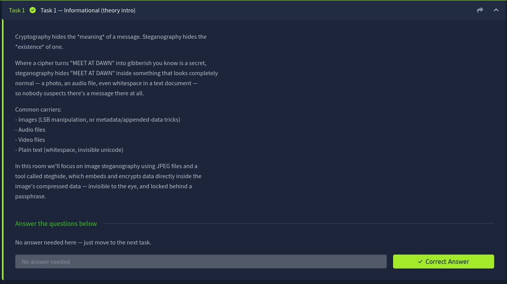
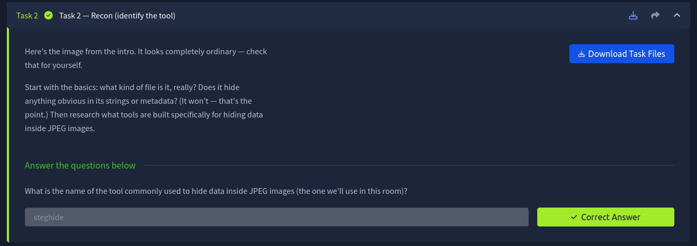
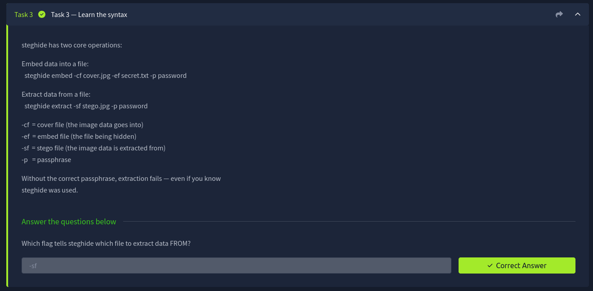
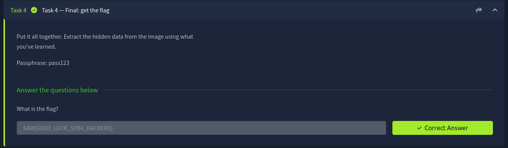

# TryHackMe Write-up: SYB4 Bootcamp

**Difficulty:** Beginner  
**Topic:** Image Steganography  

## Overview
The SYB4 Bootcamp is an introductory steganography room designed to cover the fundamental concepts of hiding data inside files. The practical exercises focus heavily on extracting encrypted payloads from JPEG images using `steghide`.

---

## Task 1: Informational (Theory intro)



This task establishes the baseline difference between cryptography and steganography:
*   **Cryptography** hides the *meaning* of a message (e.g., turning text into ciphered gibberish).
*   **Steganography** hides the *existence* of the message (e.g., embedding the text inside a normal-looking photo).

Common carriers for hidden data include:
*   Images (via LSB manipulation, appended data, or metadata tricks).
*   Audio and Video files.
*   Plain text (using whitespace or invisible unicode characters).

*No answer required for this task.*

---

## Task 2: Recon (Identify the tool)



The first objective is to identify the correct tool for the job. While formats like PNG often utilize Least Significant Bit (LSB) manipulation, JPEG images use lossy compression, requiring tools that embed data directly into the compressed data structural coefficients.

**Question:** What is the name of the tool commonly used to hide data inside JPEG images (the one we'll use in this room)?  
**Answer:** `steghide`

---

## Task 3: Learn the syntax



Before extracting the flag, it is necessary to understand `steghide`'s core command syntax for both embedding and extracting data.

The primary flags used are:
*   `-cf` (Cover File): The file the data is being hidden inside.
*   `-ef` (Embed File): The actual secret file being hidden.
*   `-sf` (Stego File): The manipulated file from which you are extracting data.
*   `-p` (Passphrase): The password used to encrypt/decrypt the payload.

**Question:** Which flag tells steghide which file to extract data FROM?  
**Answer:** `-sf`

---

## Task 4: Final (Get the flag)



The final task requires applying the syntax learned in Task 3 to extract the hidden flag from the provided task image. The creator provided the passphrase directly rather than requiring a brute-force attack.

**Execution:**  
Using the standard extraction syntax, the command run against the downloaded task file would be:

```bash
steghide extract -sf stego101-1787644613030.jpg -p pass123

```

**Question:** What is the flag?  
**Answer:** `SAW{G00D_LUCK_SYB4_HACKERS}`
